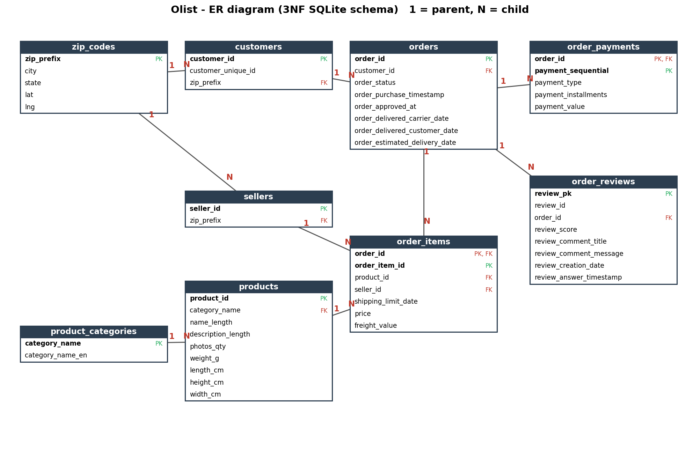
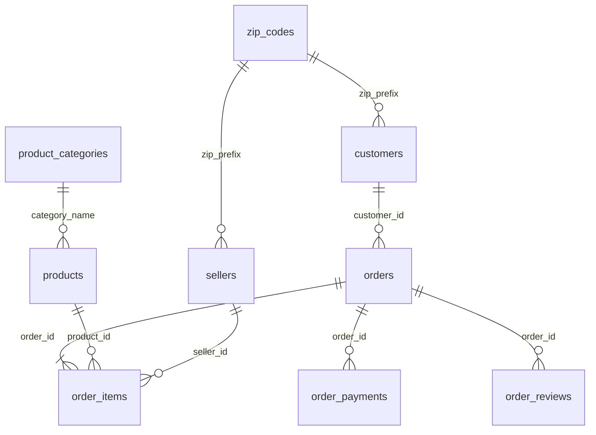

# E-commerce Marketplace Analytics (Olist)

Final project, *Programming for Data Analysis and Database* (Topic 2, ADA-2603M).
Team: Dinmukhamed Laiykov, Amir Nurseit, Aidyn Nurlan.

Analysis of orders, delivery delays, seller performance and customer cohorts on the
[Olist Brazilian E-commerce](https://www.kaggle.com/datasets/olistbr/brazilian-ecommerce) dataset (9 related tables,
~100K orders, 1M geolocation rows). Focus: multi-table JOINs and cohort retention in SQL.

## Run

**Python 3.10-3.12** (3.13 is not supported: `numpy==1.26.4` and `pyarrow==17.0.0` have no wheels for it; the code uses `dict | None` syntax, which needs 3.10+). Works in Google Colab (Python 3.12).

```bash
python -m venv .venv && .venv\Scripts\activate      # Windows
pip install -r requirements.txt
# put the 9 CSV files into data/raw/  (or menu item 1 tries kagglehub; needs Kaggle credentials)
python main.py            # interactive menu
python main.py --all      # whole pipeline
```

Menu order: 1 download -> 2 optimise/Parquet -> 3 audit -> 4 build DB -> 5/6/7/8 analysis. Outputs go to `outputs/`.

## Structure

| File | Purpose |
|---|---|
| `config.py` | paths and constants |
| `data_loader.py` | chunked CSV reading, dtype optimisation, Parquet conversion, CSV-vs-Parquet benchmark |
| `audit.py` | data quality audit (missing values, duplicates, business-rule checks) |
| `schema.sql`, `database.py` | 3NF SQLite schema, loading, `query_df` (SQL -> Pandas) |
| `queries.py` | 11 SQL queries (JOIN, GROUP BY/HAVING, subqueries, CTEs, window functions, cohort retention) |
| `benchmark.py` | same calculation in SQL vs Pandas: time + result equality check |
| `ml_models.py` | late-delivery prediction: baseline vs Logistic Regression vs Random Forest, chronological split |
| `visuals.py` | 6 Seaborn figures from query results |
| `main.py` | console menu |

## ER diagram





## Approach comparison

1. CSV vs Parquet (size, read time) and memory before/after dtype optimisation - `outputs/csv_vs_parquet.csv`, `outputs/memory_report.csv`.
2. SQL vs Pandas on the same computation, with equality check - `outputs/sql_vs_pandas.csv`.
3. Models for late delivery (baseline majority class vs LR vs RF), time-based split, F1/ROC-AUC/time/size - `outputs/model_comparison.csv`.

## Notes
- The dataset is ~120 MB / 1.5M rows in total; the geolocation table (1M rows) is processed in chunks.
- All results (tables, figures) are written to `outputs/`.
